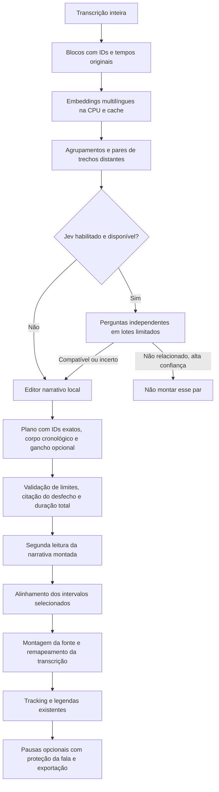

# Montagem narrativa, pausas e Jev

Implementação de 18–19/09/2026. As opções são adicionais e desligadas por padrão.
Os parâmetros de legenda, rastreamento, zoom e composição aprovados foram mantidos.

## Uso

Editar histórias, retirar digressões quando isso não altera o sentido e encurtar
pausas longas, preservando 0,18 s de cada lado:

```bash
.venv/bin/python main.py --input data/downloads/davy-jones.mp4 \
  --narrative-edit --remove-silence \
  --silence-threshold-db -40 --silence-min-seconds 0.9 \
  --silence-padding-seconds 0.18
```

Encontrar retomadas distantes com embeddings locais, montar histórias e permitir
um trecho chamativo repetido no começo:

```bash
.venv/bin/python main.py --input data/downloads/davy-jones.mp4 \
  --semantic-montage --hook-preview --remove-silence
```

O modelo de embeddings já foi instalado dentro deste projeto durante a validação.
Em outra instalação, a primeira execução precisa de `--download-embedding-model`.
O download é de pesos públicos, sem custo de API. Depois funciona localmente.
`--hook-max-seconds 10` limita o gancho antecipado a dez segundos.

Adicionar a triagem externa opcional:

```bash
.venv/bin/python main.py --input data/downloads/davy-jones.mp4 \
  --semantic-montage --jev-triage --hook-preview --remove-silence
```

Configure `TYPESAFE_API_KEY` no ambiente da aplicação para usar Jev. O agente não
buscou, leu nem cadastrou uma chave real. Sem chave, a montagem continua com o
editor local. `--jev-triage` ativa a busca semântica mesmo sem repetir a outra flag.
Não inclua chaves em comandos que serão compartilhados ou em commits.

Alternativa inteiramente local, com mapa narrativo gerado por Qwen em todos os
blocos: `--narrative-montage`. Ela usa mais inferência local que a recuperação por
embeddings e pode encontrar conexões que ficaram fora da lista semântica.

`--dry-run` salva propostas para revisão sem renderizar. `--no-cache` refaz
etapas; `--force-curate` refaz decisões editoriais. Arquivos anteriores são preservados.
Se nenhum corte passar pelos critérios, a CLI retorna `status: no_candidates`,
sem renderização e sem traceback genérico. Ela informa a pasta da revisão e salva
`diagnostic.json` com o motivo e o caminho da auditoria, quando fornecido pelo curador.
Esse resultado não significa que um vídeo foi gerado. Falhas de execução continuam
sendo reportadas como erros.

## Fluxo implementado



### História e desfecho

`--narrative-edit` usa os candidatos locais como ponto de partida e oferece
contexto nas bordas ao editor. Ele pode antecipar o começo, incluir a resposta
que ficou fora e excluir digressões do meio por meio de intervalos separados.
O contexto é reduzido pelas margens, sem truncar o final dos intervalos-base,
para caber no modelo de 8 GB. Evidência grande demais é recusada explicitamente.

Cada plano é validado em código: IDs reais, ordem cronológica no corpo, ausência
de sobreposição, quantidade de partes, duração somada e citação literal no último
segmento. Finais claramente pendurados em conectivos ou reticências são recusados.
Uma segunda chamada local lê **apenas a montagem proposta** para verificar
compreensão isolada, conclusão e fidelidade. Um veto não é convertido em aprovação
para preencher uma cota. Essas verificações reduzem falhas; não provam qualidade editorial.
O planejamento usa raciocínio local limitado a 4.096 tokens por chamada, com
contexto de 8.192. O mapa e a segunda leitura usam o modo sem raciocínio.
Se o orçamento de raciocínio acabar sem produzir uma resposta, há uma única
tentativa sem raciocínio. As chamadas seguintes da mesma instância também usam
esse modo rápido, evitando gastar novamente o orçamento em cada par. A auditoria
registra `empty_reasoning_response`; as verificações editoriais continuam obrigatórias.
Isso aumenta o tempo da edição opcional, sem adicionar custo de API. O editor
extrai a citação do desfecho diretamente do último ID escolhido, sem pedir ao
modelo que a reconstrua de memória.

### Gancho antecipado

O gancho é uma cópia literal de um intervalo já presente no corpo. Ele deve durar
de 1 s ao limite configurado, não pode ser simplesmente a abertura normal e
conta para a duração final. O corpo mantém a mesma passagem na posição original.
Não há voz sintética ou frase inventada. Se o editor não identificar um trecho
adequado, pode deixar a introdução antecipada vazia.

### Embeddings e agrupamentos

Modelo: `intfloat/multilingual-e5-small`, revisão fixa
`614241f622f53c4eeff9890bdc4f31cfecc418b3`, executado na CPU em lotes de oito.
O prefixo `query:` é aplicado a ambos os lados, conforme recomendado pelo
[model card](https://huggingface.co/intfloat/multilingual-e5-small) para similaridade
simétrica e agrupamento. Textos que excedem o limite real do
tokenizador são divididos e suas representações combinadas, sem omissão silenciosa.
Os pesos ficam em `data/models/embeddings`; não competem pela VRAM do Whisper,
Qwen ou rastreador.

Todos os segmentos entram em blocos de até aproximadamente 45 s/1.200 caracteres.
Um segmento individual maior permanece inteiro para não inventar limites de fala.
O agrupamento exige similaridade com todos os membros do grupo, evitando que
uma cadeia A–B–C una A e C quando estes são pouco relacionados. A busca sugere
até 12 pares separados por pelo menos 60 s, com limite de reutilização por bloco.
Similaridade de 0,90 é uma configuração inicial, **não uma probabilidade calibrada**.
Pares recuperados podem continuar falando de acontecimentos distintos.

Se os pesos estiverem indisponíveis, há aviso explícito e alternativa pelo mapa
narrativo local. Não é usado TF-IDF como se fosse embedding semântico. Se todos
os pares forem vetados pelo Jev, eles não são automaticamente reaprovados pela
alternativa. A seleção pode retornar nenhum corte.

### Jev: decisão limitada, edição local

O contrato segue `POST https://api.typesafe.ai/v1/systemone`, com `state`, `model`
e um mapa de `questions`. Cada par recebe uma pergunta `Choice` com três respostas:
`compatible`, `unrelated` e `needs_context`. A pergunta identifica o par dentro
do estado e distingue continuação narrativa de mera semelhança de assunto.
As respostas são validadas: tipo, opção, distribuição de probabilidades,
normalização, confiança e modelo retornado. [Referência HTTP](https://docs.typesafe.ai/api)

Confiança e probabilidade da opção precisam atingir 0,8 para um veto automático
de par não relacionado. Incertos vão ao editor local. Até pares classificados
como compatíveis ainda precisam de um plano e de validação narrativa; Jev não
recebe a responsabilidade de calcular timestamps ou gerar cortes. Essa divisão
segue as limitações publicadas sobre números, geração e contexto irrelevante.
[Limitações do Jev 1.13](https://docs.typesafe.ai/model-jaggedness/jev-1.13)

Há um único request com perguntas paralelas quando o material cabe. Para episódios
maiores, são feitos pequenos lotes, sequencialmente, com estado de até 18.000 bytes
e payload conservador de até 50.000 bytes incluindo margem. O contexto filtrado
ajuda a evitar distração por outros assuntos. Não são disparadas chamadas sem limite.
[Perguntas paralelas](https://docs.typesafe.ai/patterns/fan-out)

`Choice` possui confiança derivada da distribuição; ela não garante correção
individual. Os limiares ainda precisam de calibração em podcasts em português.
[Confiança](https://docs.typesafe.ai/confidence)

### Custo e disponibilidade

Modelo fixado: `jev-1.13.0`. Preço verificado em 18/09/2026: **US$ 0,042 por milhão
de tokens de entrada, saída gratuita**. Por exemplo, 100 mil tokens de entrada
custariam US$ 0,0042, antes de eventuais condições comerciais da conta. Isso é
uma estimativa pelo preço publicado, não uma fatura medida. O fornecedor informa
que inglês é a língua em que o modelo tem melhor desempenho.
[Modelos, preços e idiomas](https://docs.typesafe.ai/models)

O teto de reservas conservadoras é `min(JEV_BUDGET_USD, API_BUDGET_USD)`, com
`JEV_BUDGET_USD=0.01` por execução do vídeo. UTF-8 em bytes mais uma margem é
usado como limite conservador de tokens antes de enviar cada lote. O consumo
reportado pelo servidor é registrado quando disponível. Cache não reserva custo.
Timeouts mantêm a reserva e **não** são repetidos automaticamente. Sem chave,
com orçamento esgotado, resposta inválida ou erro HTTP, usa-se o editor local.
Um modelo diferente do fixado requer atualização da integração/preço; não herda
silenciosamente a tarifa antiga.

Só os textos dos pares pré-selecionados são enviados ao Jev. Áudio e vídeo ficam
locais. A chave não entra em cache, prompts, logs ou arquivos de auditoria.
Não foi feita chamada real ao Jev durante a implementação; o contrato foi testado
com respostas simuladas. Não há avaliação empírica da precisão do serviço aqui.

### Pausas e renderização

`--remove-silence` usa detecção acústica do FFmpeg. `--silence-threshold-db`
controla o nível de áudio; `--silence-min-seconds`, a pausa mínima elegível;
`--silence-padding-seconds`, a margem preservada **em cada borda**. Assim, margem
de 0,18 s deixa aproximadamente 0,36 s em uma pausa interna encurtada.

Os intervalos das palavras, com margem adicional, são protegidos: uma sílaba
baixa reconhecida na transcrição não é removida só por ficar abaixo do limiar
acústico. Os limites preservados são arredondados para fora na grade de quadros.
Legendas, áudio e trajetória da câmera compartilham os mesmos cortes temporais.
Se a temporização da transcrição estiver errada, essa proteção também fica limitada.

Montagens usam um encode intermediário NVENC por passagem selecionada, em ordem,
seguido de concatenação sem reencode adicional. Há microfades de áudio de 5 ms
nas junções para reduzir estalos. A transcrição é remontada com IDs únicos e
palavras nos novos tempos; depois entra no rastreamento e estilo já existentes.
Isso exige trabalho adicional e espaço para intermediários. Não há transição
visual inventada: são cortes secos. Os arquivos ficam preservados para revisão.

## Arquivos e auditoria

- `src/narrative.py`: planejamento local, mapa global e validação dos planos.
- `src/semantic.py`: blocos, embeddings, cache, agrupamentos e recuperação de pares.
- `src/jev.py`: contrato HTTP, lotes, cache, orçamento e encaminhamento local.
- `src/montage.py`: concatenação da fonte e remapeamento de transcrição.
- `src/models.py`: intervalos `source_spans`, na ordem real de reprodução.
- `src/transcriber.py`: alinha só as partes selecionadas, sem processar o intervalo
  inteiro entre momentos distantes.
- `src/renderer.py`: recebe a fonte montada; protege palavras no encurtamento de pausas.
- `src/quality_review.py`: ajusta cada parte às palavras e oferece revisão por partes.
- `main.py`, `src/config.py`, `src/pipeline.py`: argumentos, configuração, cache e integração.
- `tests/test_narrative.py`: limites, repetição, tempos, pausas, API e FFmpeg real.
- `scripts/validate_narrative.py`: exercício com o podcast local, sem `.env` ou API paga.

`data/editorial-plans/run-*/` contém índice semântico, pares, decisões, reservas,
prompts/respostas e cortes aprovados. A pasta de saída contém `edits/run-*/`, com
as partes, a fonte montada, a nova transcrição e `edit-decision-list.json`.
Esse manifesto relaciona a fonte original ao vídeo montado, antes da remoção
opcional de pausas. A revisão HTML mostra cada parte ou o vídeo final, quando renderizado.

As novas variáveis estão documentadas em `.env.example`. Nenhum `.env` real foi
lido ou alterado pelo agente; nenhuma chave real foi usada. Nenhum arquivo foi apagado.

## Validação observada em 18–19/09/2026

O podcast local de Davy Jones e Igor 3K foi usado para recuperação semântica e
tentativas reais do editor `qwen3.5:4b`. O modelo E5 roda em CPU, com até quatro
threads, preservando a VRAM para o editor e o processamento visual. A configuração
final usa o prefixo `query:` nos dois lados, conforme a recomendação do modelo
para similaridade simétrica, e limiar de 0,90. [Model card E5](https://huggingface.co/intfloat/multilingual-e5-small)

Foram encontrados **157 blocos, 39 grupos e 12 pares**; o maior grupo tem nove
blocos. O limiar de 0,84 produzia apenas três grupos, com 82 blocos no maior,
misturando assunto demais. Esse ajuste é empírico neste episódio; não equivale a
uma calibração universal. A execução com embeddings finais sem cache levou
34,46 s; recuperação dos vetores em cache e agrupamento final levaram 0,217 s.
São medições individuais de etapas, não ganho de velocidade da pipeline inteira.

Os 12 pares cabem em um lote Jev: reserva conservadora de 29.099 bytes/tokens
de entrada, incluindo margem, estimada em **US$ 0,001222158**. Requisições reais:
**zero**. O custo efetivo e a precisão em português continuam sem medição.
Os dados estão em
`data/validation/narrative/run-20260919T015743-09a0bbdb/semantic-final-090.json`.

**A qualidade editorial automática da montagem permanece experimental.** Nas
tentativas reais registradas, o modelo local devolveu referências inconsistentes,
veto excessivo ou esgotou o raciocínio sem uma resposta utilizável. As proteções
rejeitaram essas propostas; não foi relaxado o limiar de qualidade para fabricar
um resultado. Portanto, implementar o fluxo não comprova que ele já supera a
seleção anterior. Use `--dry-run` e revise as propostas antes de adotar o modo em
lote. O modo visual padrão continua disponível com as configurações anteriores.

O teste automatizado de FFmpeg usa vídeo e áudio reais gerados como fixture,
verificando duração e repetição da transcrição. Já
`scripts/validate_montage_render.py` usa mídia do podcast com um **plano manual**,
explicitamente identificado: serve para testar montagem, legendas e renderização,
não para atribuir qualidade editorial à IA. Todos os resultados ficam em novas
pastas, preservando fontes e intermediários.

Essa renderização manual foi concluída em
`data/validation/montage-render/run-20260919T170526-5eb9fbad/`:
35,43 s, H.264/AAC, 1080×1920 e 30 fps. Áudio e vídeo diferem em menos de um
milissegundo de duração. Montagem, tracking e exportação levaram 99,09 s juntos;
não é uma comparação controlada de desempenho com o pipeline anterior.
Os quadros de conferência mantêm o enquadramento e as legendas no estilo existente.
Não houve pausa acústica elegível nesse trecho com os limiares padrão: ele
não mede economia de tempo por silêncio. A proteção de palavras e as margens
foram verificadas nos testes automatizados.

Em uma tentativa automática, o fallback de raciocínio funcionou, mas o modelo
devolveu título vazio e depois repetiu o mesmo intervalo. O plano foi recusado
em 21,76 s. Auditoria:
`data/validation/narrative-final/run-20260919T170747-6bbe4972/`.
O schema passou a exigir título não vazio e a declarar intervalos únicos,
mantendo a validação em Python. A tentativa seguinte produziu limites válidos e
um título, mas recebeu nota 5 e foi vetada pela segunda leitura: nenhum corte
aprovado. Levou 18,33 s, registrado em
`data/validation/narrative-final/run-20260919T170935-7e92565a/`.
O schema da segunda leitura também exige uma justificativa não vazia.
O conjunto completo passou com **83 testes**; após o ajuste que evita repetir
raciocínio esgotado, os **28 testes narrativos** passaram novamente.

### Correção após o teste `teste-montagem`

O log de 19/09 apresentou seis vetos em que os booleanos do revisor não
correspondiam à justificativa: por exemplo, `standalone=false` junto de
“Nenhuma falha de edição detectada”. A revisão agora usa uma decisão única:
`aprovar`, `rejeitar` ou `incerto`. Não se deduz aprovação de texto livre.
Uma rejeição exige uma citação literal da montagem ou do título. Respostas
malformadas têm uma tentativa de correção; incerteza não aprova o plano.
Essa alteração muda a interface da decisão, sem reduzir o limiar de nota.

O planejador também recebe a lista explícita de janelas disponíveis com IDs
e durações. Um intervalo não pode atravessar lacunas; histórias acima do limite
continuam sendo recusadas, sem truncar automaticamente o desfecho. O cache de
seleção final mudou de versão para não reutilizar decisões anteriores à correção.

Regressão: **91 testes passaram**, incluindo decisão explícita, rejeição com
evidência inventada, incerteza, janelas separadas e CLI sem candidatos preservando
resultados anteriores. Na repetição dos seis planos antigos, o novo revisor
aprovou um plano antes vetado pelo booleano contraditório; a nota desse plano
continuou abaixo do limiar, portanto ele não foi promovido artificialmente.

Uma execução completa posterior com os 12 pares, o mesmo podcast e o mesmo modelo
local aprovou **um candidato de 136,02 s**, em **128,82 s**, sem reduzir o limiar
de nota. O plano aprovado é contínuo e não contém preview: esse resultado não
comprova ainda a qualidade de uma costura distante ou de um gancho antecipado.
Não houve renderização nem chamada paga. Proposta e revisão local:
`data/validation/montage-fix/run-20260919T172411-93826cea/`.

Para repetir o teste, use o mesmo comando `teste-montagem` com `--dry-run`.
Não é necessário apagar cache nem arquivos. Para solicitar decisões novas em
vez de respostas locais já salvas, acrescente `--force-curate` (isso aumenta o
tempo e pode alterar as propostas).

### Limitação numérica do contexto e propostas pendentes

O segundo teste do usuário ainda retornou zero candidatos: várias propostas
tentavam incluir cerca de 270 s em um limite de 180 s. Agora o código reduz as
margens de contexto (45, 20, 5, 0 s) até que a soma das janelas disponíveis caiba
no limite, reservando a duração máxima do preview. Os trechos-base e seus finais
não são truncados. Se o corpo sem margens só couber sem preview, o prompt orienta
`preview=null`; se nem assim couber, o candidato é recusado antes da inferência.
Essa redução pode limitar a descoberta de desfechos fora das janelas: não garante
uma história completa. A validação da narrativa permanece necessária.

Números dos limites nos prompts são normalizados (`30` e `30.0`, por exemplo,
passam a gerar o mesmo texto). Isso evita diferenças desnecessárias entre
configuração direta e argumentos da CLI, inclusive nas chaves de cache.

Os planos que passam pelos limites temporais são salvos em `proposals.json`,
com decisão e justificativa. Os rejeitados, incertos, abaixo da nota mínima ou
com erro no revisor aparecem em `pending-review/review.html`, explicitamente
marcados **PROPOSTA NÃO APROVADA**. Essa página permite assistir às partes da
fonte sem gerar um vídeo final. Eles não entram na lista de renderização.
O resultado `no_candidates` informa esse caminho. Nenhum limiar foi reduzido.

Na validação com contexto limitado, os 12 pares foram processados em 110,81 s,
sem os erros de duração acima de 180 s observados anteriormente. Isso resolveu
o problema numérico, não a qualidade editorial. Uma proposta recebeu decisão
`aprovar` com justificativa que afirmava haver falhas. Ela não deve ser tratada
como sucesso editorial: a nova revisão, em
`data/validation/contradiction-recheck/run-20260919T173651-47456f49/`, a rejeitou.

A justificativa e a evidência agora precedem a decisão no schema. Além disso,
aprovações com a forma explícita de contradição encontrada (“A transcrição
apresenta falhas...”) exigem nova avaliação. Esse teste textual é limitado e não
detecta toda contradição possível. Portanto, o editor 4B continua experimental;
não foi demonstrada uma montagem distante automaticamente aprovada e confiável.
A revisão humana das propostas permanece necessária. A suíte passou com 93
testes antes dos últimos dois casos de regressão; os 39 testes narrativos,
incluindo esses casos, passaram após a alteração final.
