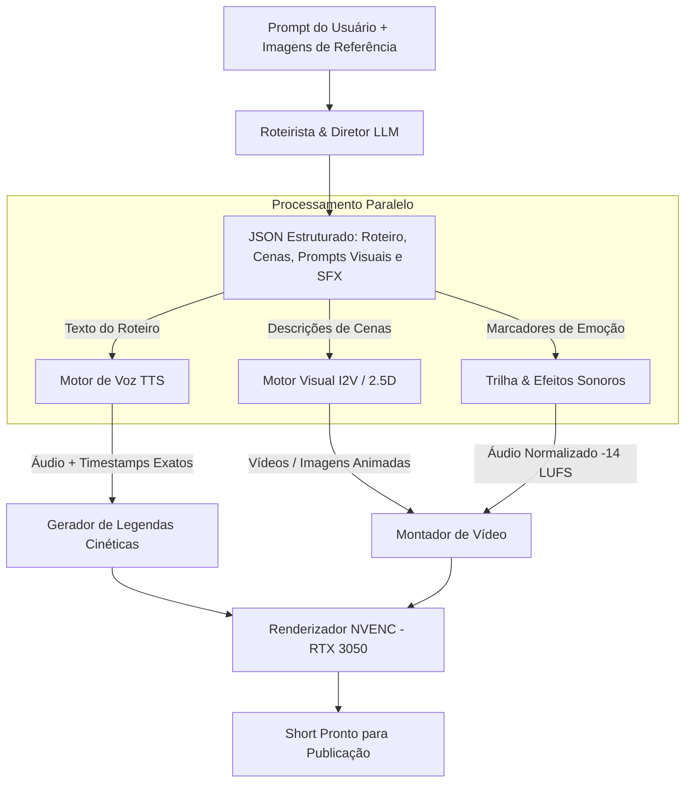
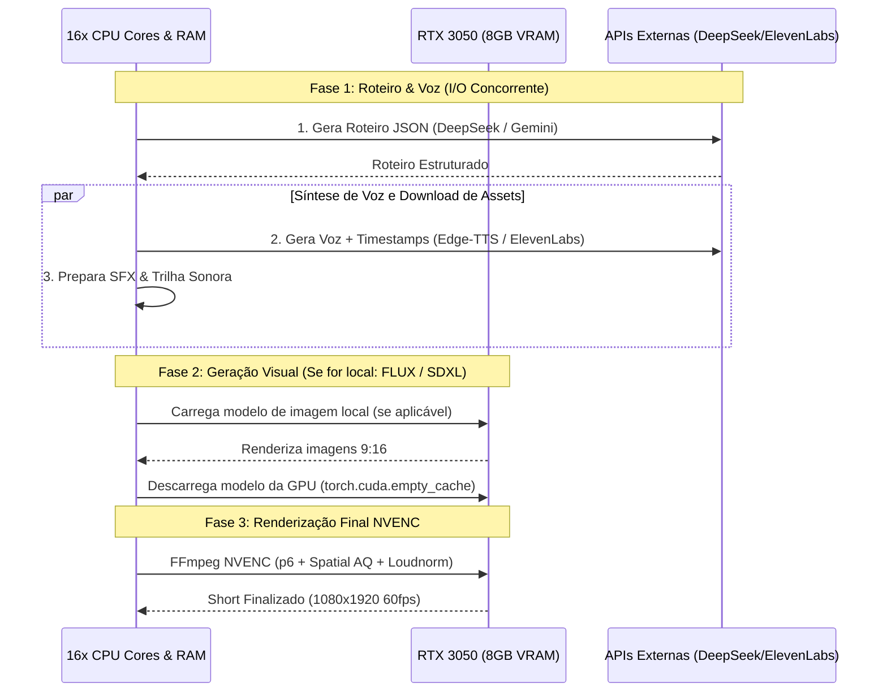

# Plano Arquitetural: Gerador de Shorts do Zero (Prompt + Imagens)

Este documento estabelece o projeto técnico, a filosofia arquitetural e o plano de implementação para estender o pipeline existente, permitindo a **criação de Shorts 100% originais a partir de um prompt e imagens de referência**.

O design adota uma arquitetura em **três camadas de resiliência** (API Paga $\rightarrow$ API Gratuita $\rightarrow$ Execução Local 100%), priorizando a máxima qualidade visual e sonora, paralelismo de I/O, otimização de VRAM na RTX 3050 (8GB) e reaproveitamento integral dos motores de legendagem cinética e renderização NVENC já desenvolvidos.

---

## 1. Visão Geral do Sistema

O objetivo é permitir que o usuário digite um tema/prompt (ex: *"A história do maior roubo de diamantes da história"* ou *"3 curiosidades chocantes sobre buracos negros"*) e, opcionalmente, envie imagens de referência. O sistema orquestrará a criação do roteiro, a narração em voz humana com sincronia labial/palavra, a animação visual, a trilha sonora de fundo, os efeitos sonoros contextuais e a renderização final em 1080x1920 a 60 FPS.



---

## 2. Matriz de Resiliência: Três Camadas de Execução

Cada etapa da criação conta com uma cadeia de fallback automático. Se a API primária (paga) falhar ou estiver sem créditos, o sistema cai imediatamente para a camada gratuita em nuvem, e em última instância para a geração 100% local.

| Estágio | 🥇 Camada 1: Paga (Qualidade Máxima) | 🥈 Camada 2: Gratuita (Cloud Fallback) | 🥉 Camada 3: Local (Zero Dependência / Offline) |
| :--- | :--- | :--- | :--- |
| **1. Roteirização & Storytelling** | **DeepSeek-V4.1-Flash** (Reasoning Effort 75) ou Claude 3.5 Sonnet | **Gemini 3.8 Flash** (Google AI Studio Free Tier - 1M contexto) | **Ollama** (Llama-3.3-8B / Mistral) |
| **2. Voz Neural (TTS + Timestamps)** | **ElevenLabs API** (Vozes hiper-realistas com emoção adaptativa) | **Microsoft Edge-TTS** (Vozes neurais da Azure gratuitas: *Francisca*, *Antonio*, etc.) | **Kokoro-82M** / **Chatterbox** (Inferência local em <1s na RTX 3050) |
| **3. Geração Visual (Imagens)** | **Midjourney v6** / **FLUX.1 Pro** via Fal.ai / Replicate | **Google Imagen 3** (via Gemini API Free) / **Pollinations.ai** | **FLUX.1 Schnell GGUF** / **SDXL Turbo** (Inferência local via ComfyUI ou Diffusers) |
| **4. Animação Visual (Motion)** | **Kling 1.5** / **Luma Dream Machine** / **Wan2.1 API** (Image-to-Video real) | **Efeito Ken Burns 2.5D Dinâmico** (Zoom, Parallax e Pan suaves via FFmpeg) | **FFmpeg GPU Filters** (Transformações afins e transições de cena aceleradas por NVENC) |
| **5. Legendas & Tipografia** | Reutiliza [src/captions.py](src/captions.py) | Reutiliza [src/captions.py](src/captions.py) | Reutiliza [src/captions.py](src/captions.py) |
| **6. Renderização & Áudio** | Reutiliza [src/renderer.py](src/renderer.py) (NVENC p6, -14 LUFS) | Reutiliza [src/renderer.py](src/renderer.py) | Reutiliza [src/renderer.py](src/renderer.py) |

---

## 3. Detalhamento Técnico dos Estágios

### Estágio 1: O "Diretor Virtual" (Roteirização e Storyboarding)
Um prompt detalhado do usuário não deve gerar apenas um texto corrido. O LLM atua como um diretor cinematográfico de Shorts, produzindo um esquema JSON estruturado contendo:

```json
{
  "title": "O Mistério da Ilha de Páscoa",
  "total_estimated_duration": 45.0,
  "scenes": [
    {
      "scene_id": 1,
      "narration": "Você sabia que essas estátuas gigantes têm corpos inteiros enterrados no chão?",
      "visual_prompt": "Cinematic close-up of a giant Easter Island Moai statue, dramatic sunset lighting, photorealistic 8k, vertical 9:16",
      "motion_type": "slow_zoom_in",
      "sfx": "whoosh_impact",
      "b_roll_keyword": "moai_statue"
    },
    {
      "scene_id": 2,
      "narration": "Em 2012, escavações arqueológicas revelaram algo que chocou o mundo...",
      "visual_prompt": "Archaeological excavation uncovering the underground torso of an ancient stone statue, dust particles, realistic documentary style",
      "motion_type": "pan_down",
      "sfx": "tension_riser",
      "b_roll_keyword": "excavation"
    }
  ]
}
```

### Estágio 2: Síntese de Voz com Sincronia Precisa (Word-Level Alignment)
Para alimentar o motor de legendas [src/captions.py](src/captions.py), é indispensável que o TTS entregue não apenas o áudio (`.wav`), mas também o tempo de início e término de cada palavra:
* **No Edge-TTS (Gratuito):** A biblioteca emite eventos de WebSocket com mensagens do tipo `WordBoundary`, trazendo os offsets em milissegundos de cada palavra.
* **No ElevenLabs (Pago):** A API com parâmetro `output_format=pcm_24000` suporta timestamps de palavras na rota `/v1/text-to-speech/{voice_id}/with-timestamps`.
* **No Kokoro-82M (Local):** É feito um pós-alinhamento relâmpago de 0.2s via Dynamic Time Warping (DTW) ou Whisper rápido.
* O resultado é convertido diretamente para os objetos `TranscriptSegment` e `WordTimestamp` já existentes em [src/models.py](src/models.py).

### Estágio 3: Geração Visual e Animação de Câmera
As imagens de cada cena podem vir de:
1. **Imagens enviadas pelo usuário** (ex: fotos de um produto, fotos históricas ou capturas de tela).
2. **Imagens geradas por IA** baseadas no `visual_prompt` criado no Estágio 1.

Para transformar essas imagens em vídeo vertical 9:16:
* **Modo A (Efeito Cinematográfico 2.5D Ken Burns - Recomendado para Custo 0 / Local):**
  * O FFmpeg redimensiona a imagem para 1200x2133 (maior que 1080x1920) e aplica um filtro suave de `zoompan` com interpolação bicúbica e rotação sutil de 0.5 graus.
  * Dá vida imediata à imagem estática, simulando uma filmagem de câmera profissional em movimento.
  * **Consumo de recursos:** Zero custo de API, processamento instantâneo via GPU.
* **Modo B (Vídeo Generativo com IA - Kling / Luma / Wan2.1 API):**
  * A imagem estática é enviada como frame inicial (Init Frame) para uma API de Image-to-Video.
  * Gera um clipe de 4 a 5 segundos de vídeo com física real (água se movendo, folhas balançando, fumaça, movimento facial).

### Estágio 4: Composição de Áudio e Normalização EBU R128
* As faixas de narração de cada cena são concatenadas com crossfades microscópicos (10ms) para evitar cliques.
* Uma trilha musical de suspense, curiosidade ou épica (selecionada de uma pasta `assets/music/` ou gerada) é mixada com *ducking* automático (o volume da música baixa 18 dB sempre que houver fala).
* Efeitos sonoros (`assets/sfx/whoosh.wav`, `glitch.wav`, `impact.wav`) são disparados nos segundos exatos indicados no roteiro.
* O conjunto passa pelo filtro [loudnorm](src/renderer.py) a **-14 LUFS**.

### Estágio 5: Renderização Final NVENC
* O [ShortsRenderer](src/renderer.py) recebe a sequência de vídeos animados e o arquivo `.ass` com as legendas dinâmicas.
* A renderização ocorre em paralelo (`RENDER_PARALLEL_JOBS=2`) com o codec `h264_nvenc`, preset `p6`, `spatial-aq` e `temporal-aq` configurados para qualidade máxima de estúdio.

---

## 4. Estrutura Modular Proposta

Para não poluir o fluxo atual de corte de podcasts, o novo sistema residirá em um pacote dedicado `src/generator/`, integrando-se harmonicamente aos módulos existentes:

```text
src/
├── generator/
│   ├── __init__.py
│   ├── director.py             # Orquestrador do fluxo criativo
│   ├── scriptwriter.py         # Prompts e LLMs (DeepSeek -> Gemini -> Ollama)
│   ├── voice_engine.py         # TTS com timestamps (ElevenLabs -> Edge-TTS -> Kokoro)
│   ├── visual_engine.py        # Gerador de imagens e animador 2.5D Ken Burns
│   └── audio_composer.py       # Mixagem de trilha, SFX e ducking
│
├── captions.py                 # [REAPROVEITADO] Legendas Cinéticas ASS
├── renderer.py                 # [REAPROVEITADO] Motor NVENC + Loudnorm -14 LUFS
├── sound_effects.py            # [REAPROVEITADO] Catálogo de SFX
└── config.py                   # Configurações centralizadas
```

### Novos Parâmetros no CLI ([main.py](main.py)):
```bash
# Modo 1: Criação 100% autônoma via prompt
python main.py --mode generate \
  --prompt "A história secreta de como foi construída a Muralha da China" \
  --tts-voice pt-BR-AntonioNeural \
  --motion ken_burns

# Modo 2: Criação utilizando imagens de referência fornecidas pelo usuário
python main.py --mode generate \
  --prompt "Apresente as 3 melhores novidades do setup gamer 2026" \
  --reference-images "./fotos_setup/" \
  --tts-provider edge-tts
```

---

## 5. Estratégia de VRAM e Paralelismo na RTX 3050 (8GB)

A geração de conteúdo sintético exige disciplina estrita de memória para não colidir com os 8GB de VRAM da placa de vídeo:



1. **Paralelismo de I/O na Nuvem:** A síntese de voz e a geração das imagens das cenas acontecem em paralelo via `ThreadPoolExecutor(max_workers=4)`. Enquanto a voz está sendo gerada, as imagens das 5 cenas são produzidas simultaneamente.
2. **Ciclo de Vida de VRAM:** Se o usuário optar por gerar as imagens localmente via FLUX/SDXL, o modelo é carregado, processa as imagens e é **imediatamente descarregado da VRAM** antes do FFmpeg começar a renderizar o vídeo, garantindo que o NVENC tenha 100% da VRAM livre.
3. **Zero Espera no Efeito 2.5D:** Como o efeito Ken Burns de animação de imagem é executado através de matrizes afins no FFmpeg, ele é processado a mais de **180 frames por segundo** na RTX 3050, tornando a criação do vídeo de 60 segundos quase instantânea (menos de 15 segundos no total).

---

## 6. Roadmap de Implementação Proposto

* **Fase 1 (MVP Rápido - Custo Zero e Máxima Estabilidade):**
  * Implementação de `src/generator/scriptwriter.py` (DeepSeek-V4.1-Flash com fallback Gemini 3.8 Flash).
  * Implementação de `src/generator/voice_engine.py` com `edge-tts` (gratuito, sem limites, vozes neurais brasileiras de ponta e extração de word timestamps).
  * Animação de imagens estáticas ou de referência com Efeito Ken Burns 2.5D dinâmico em FFmpeg.
  * Integração direta com `ShortsRenderer` e `BrainRotCaptionBuilder`.
* **Fase 2 (Adição de Camadas Premium):**
  * Integração da API da ElevenLabs para vozes clones e entonação hiper-realista.
  * Integração de Image-to-Video via API (Kling AI / Fal.ai) para geração de vídeos com física real.
* **Fase 3 (Interface Web):**
  * Criação da aba **"Criar Short do Zero"** no dashboard web existente (`ui/index.html`), permitindo digitar o prompt, subir as fotos de referência por drag-and-drop e escutar o preview da voz antes de renderizar.

---

> [!NOTE]
> Este documento serve como especificação arquitetural completa para a expansão do projeto. Quando você desejar iniciar a implementação dessa funcionalidade, ela poderá ser construída de forma totalmente não-destrutiva em relação ao pipeline atual.
